<div align="center">

# Diagran

**Editor visual de fluxogramas, pipelines de dados, arquiteturas e modelos ER — instalado com um comando no Claude e no Codex.**

Escreva `A --> B{Decisão?}` ou arraste formas, e o Diagran organiza o desenho sozinho.
Um único arquivo HTML: sem servidor, sem cadastro, sem dependências.

[](https://github.com/carlos-dataengineer/diagram/actions/workflows/ci.yml)
[](LICENSE)


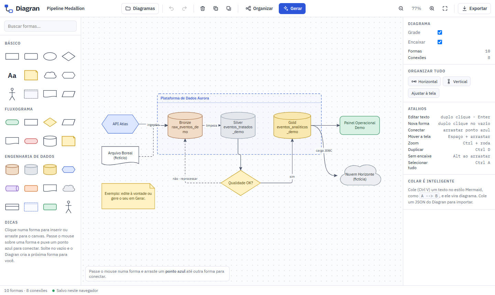

</div>

> O repositório se chama **diagram**; a ferramenta se chama **Diagran**. Todos os exemplos, modelos e imagens usam **dados fictícios**.

---

## Instale com um comando

**Windows (PowerShell)**

```powershell
irm https://raw.githubusercontent.com/carlos-dataengineer/diagram/main/install.ps1 | iex
```

**macOS / Linux**

```bash
curl -fsSL https://raw.githubusercontent.com/carlos-dataengineer/diagram/main/install.sh | bash
```

### O que acontece ao instalar

A instalação **gera a ferramenta automaticamente**. Você não precisa montar nada:

1. **A skill `diagran` é instalada** no Claude Code (`~/.claude/skills/diagran`), no Codex (`~/.codex/skills/diagran`) e na pasta compartilhada de agentes (`~/.agents/skills/diagran`).
2. **O Diagran é gerado no seu computador** em `~/Diagran/diagran.html` e **abre no navegador** na hora, já com um diagrama de exemplo.
3. **No Claude ou no Codex**, basta pedir. A skill entrega a ferramenta inteira, pronta para usar:

| Onde | O que você faz | O que a skill gera |
|---|---|---|
| **Claude** (app desktop, Claude Code, claude.ai) | `/diagran` ou *"abra o Diagran"* | Um **artefato interativo** com o editor completo, com IA, downloads e diagramas salvos na sua conta |
| **Codex** | `$diagran` ou *"abra o Diagran"* | A ferramenta em `~/Diagran/diagran.html`, aberta no navegador |
| **Qualquer agente** | *"desenhe meu pipeline no Diagran"* | O editor **já aberto com o diagrama desenhado** a partir da sua descrição |

```text
  Diagran - editor de fluxogramas, pipelines e modelos ER

  ok Skill instalada para Claude Code em ~/.claude/skills/diagran
  ok Skill instalada para Codex em ~/.codex/skills/diagran
  ok Skill instalada para agentes (pasta compartilhada) em ~/.agents/skills/diagran
  ok Ferramenta gerada em ~/Diagran/diagran.html
  ok Aberta no navegador

  Pronto. Como usar:
    Claude Code  peça "abrir o Diagran" ou digite /diagran (gera o artefato)
    Codex        peça "abra o Diagran" ou digite $diagran
    Navegador    ~/Diagran/diagran.html
```

> Abra uma **nova conversa** depois de instalar para o agente reconhecer a skill.

<details>
<summary><b>Outras formas de instalar</b></summary>

**Como plugin do Claude Code**

```text
/plugin marketplace add carlos-dataengineer/diagram
/plugin install diagran@diagran
```

**A partir de um clone** (útil para testar mudanças)

```bash
git clone https://github.com/carlos-dataengineer/diagram.git
cd diagram
./install.sh            # macOS / Linux
.\install.ps1           # Windows
```

**Só a ferramenta, sem agente:** baixe [`app/index.html`](app/index.html) e abra com dois cliques.

**Opções do instalador**

| PowerShell | Bash | Variável de ambiente | Efeito |
|---|---|---|---|
| `-NoOpen` | `--no-open` | `DIAGRAN_NO_OPEN=1` | Não abre o navegador |
| `-SkipClaude` | `--skip-claude` | `DIAGRAN_SKIP_CLAUDE=1` | Não instala no Claude Code |
| `-SkipCodex` | `--skip-codex` | `DIAGRAN_SKIP_CODEX=1` | Não instala no Codex |
| `-Ref v1.1.0` | `--ref v1.1.0` | `DIAGRAN_REF=v1.1.0` | Instala uma versão específica |

Com `irm | iex` use as variáveis de ambiente, por exemplo: `$env:DIAGRAN_NO_OPEN='1'; irm .../install.ps1 | iex`.

O instalador nunca apaga uma pasta que não seja do Diagran: se `~/.claude/skills/diagran` existir com outro conteúdo, ele avisa e pula.

</details>

<details>
<summary><b>Desinstalar</b></summary>

```powershell
irm https://raw.githubusercontent.com/carlos-dataengineer/diagram/main/uninstall.ps1 | iex
```

```bash
curl -fsSL https://raw.githubusercontent.com/carlos-dataengineer/diagram/main/uninstall.sh | bash
```

Remove as skills. Para apagar também `~/Diagran/diagran.html`, use `-All` / `--all`. Diagramas salvos no navegador não são tocados.

</details>

---

## Sumário

- [O que é o Diagran](#o-que-é-o-diagran)
- [Galeria](#galeria)
- [Casos de uso](#casos-de-uso)
- [Como usar](#como-usar)
- [Usando com o Claude e o Codex](#usando-com-o-claude-e-o-codex)
- [Texto → diagrama](#texto--diagrama-sintaxe-estilo-mermaid)
- [Atalhos de teclado e mouse](#atalhos-de-teclado-e-mouse)
- [Biblioteca de formas](#biblioteca-de-formas)
- [Importar e exportar](#importar-e-exportar)
- [Privacidade e armazenamento](#privacidade-e-armazenamento)
- [Perguntas frequentes](#perguntas-frequentes)
- [Estrutura do repositório](#estrutura-do-repositório)
- [Desenvolvimento e contribuição](#desenvolvimento-e-contribuição)

---

## O que é o Diagran

O Diagran é um editor de diagramas **leve e portátil**, pensado para quem precisa explicar um processo, uma arquitetura ou um modelo de dados **rápido**, sem abrir uma ferramenta pesada nem criar conta em serviço nenhum.

Ele tem um olhar especial para **engenharia de dados**: formas prontas para camadas Bronze/Silver/Gold, filas e streams, jobs, APIs, arquivos e dashboards, além de modelo ER com PK/FK e cardinalidade.

Você desenha de três jeitos:

| Jeito | Como funciona | Ideal para |
|---|---|---|
| 🖱️ **Arrastar e soltar** | Clique ou arraste formas da biblioteca; conecte puxando o ponto azul | Ajustes finos, apresentações |
| ⌨️ **Escrever texto** | Digite `A --> B{Decisão?}` e o Diagran monta e organiza | Rapidez, versionar diagramas como texto |
| ✨ **Descrever para a IA** | Explique o processo em português e a IA monta as formas *(no artefato do Claude)* | Primeiro rascunho de algo complexo |

**Destaques**

- 🧭 **Layout automático** horizontal ou vertical, com rotas ortogonais.
- 🧱 **Modelos prontos**: Pipeline Medallion, fluxo com contêineres, fluxograma de decisão, modelo ER e arquitetura de ingestão.
- 🎨 **12 estilos de cor** (inclusive Bronze, Silver e Gold), tema claro e escuro automáticos.
- 🗂️ **Biblioteca de diagramas** salva no navegador (e na sua conta, quando aberto como artefato no Claude).
- 📤 Exporta **PNG, SVG, JSON e Mermaid**; importa **JSON, draw.io/XML e texto Mermaid**.
- 📱 Funciona no **celular**, com toque e pinça para zoom.
- 🔒 **Tudo local**: nenhum diagrama sai do seu navegador sem uma ação sua.

---

## Galeria

<table>
<tr>
<td width="50%"><b>Fluxo com contêineres</b> (abre como exemplo)<br></td>
<td width="50%"><b>Modelo ER</b><br>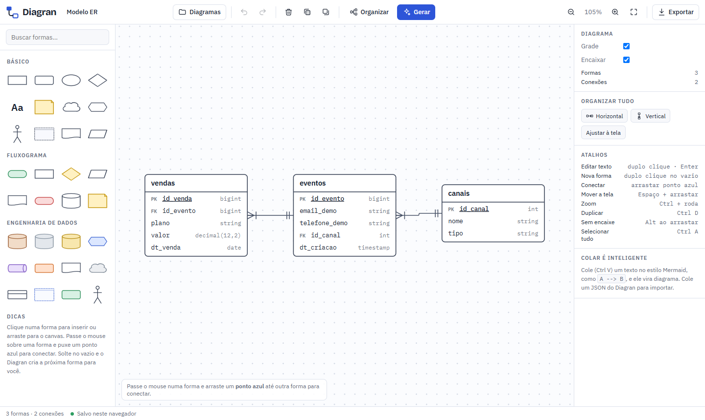</td>
</tr>
<tr>
<td width="50%"><b>Fluxograma de decisão</b><br></td>
<td width="50%"><b>Arquitetura de ingestão (tema escuro)</b><br>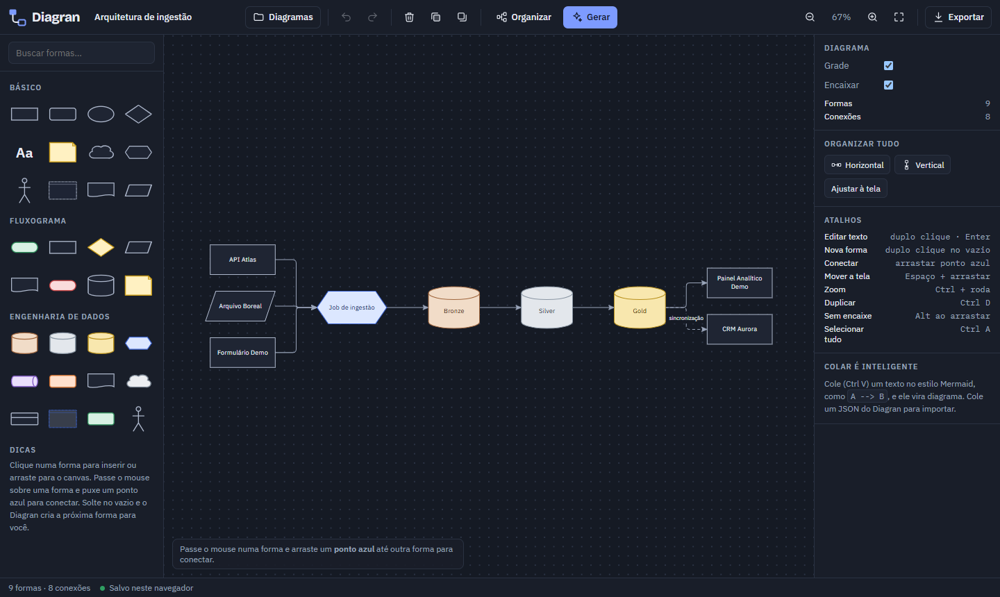</td>
</tr>
<tr>
<td width="50%"><b>Texto → diagrama</b><br></td>
<td width="50%"><b>…e o resultado, organizado sozinho</b><br>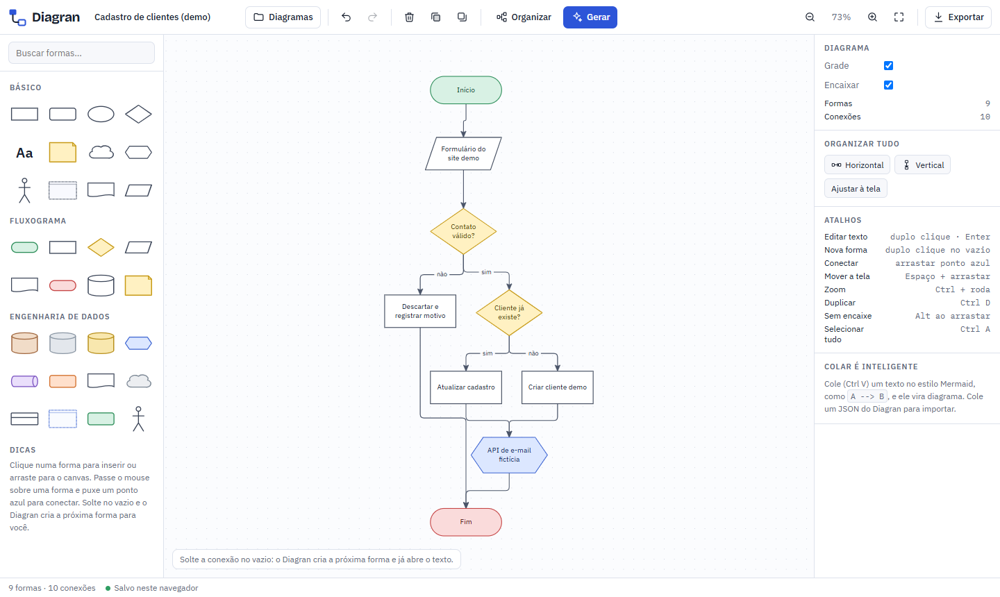</td>
</tr>
<tr>
<td width="50%"><b>Painel de propriedades</b><br>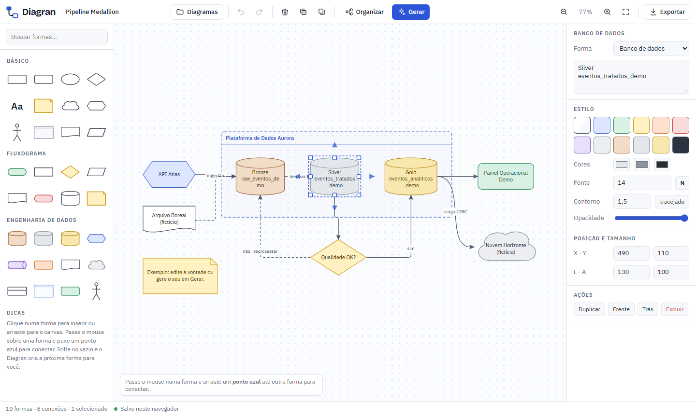</td>
<td width="50%"><b>Exportar e importar</b><br></td>
</tr>
</table>

<p align="center">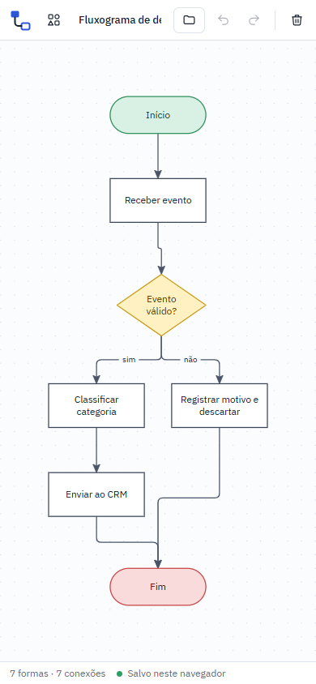</p>

---

## Casos de uso

### 1. Documentar um pipeline de dados (Medallion)

Comece pelo modelo **Pipeline Medallion** ou peça ao agente: *"desenhe no Diagran um pipeline que lê pedidos de uma API, grava em Bronze, padroniza em Silver e publica indicadores na Gold"*. Exporte em PNG para a documentação e em JSON para versionar junto do código.

### 2. Modelar tabelas antes de criar no banco

```text
tabela clientes: id_cliente bigint PK, nome_demo string, dt_cadastro date
tabela pedidos: id_pedido bigint PK, id_cliente bigint FK, valor decimal(12,2), dt_pedido date
tabela itens: id_item bigint PK, id_pedido bigint FK, sku string, qtd int
pedidos --> clientes
itens --> pedidos
```

Cole no canvas (`Ctrl+V`) e as tabelas aparecem com colunas, chaves e cardinalidade.

### 3. Fluxograma de processo de negócio

Aprovação de pedidos, cadastro de clientes, atendimento: use decisões com `{Pergunta?}` e rótulos `-->|sim|` / `-->|não|`. O layout vertical (`flowchart TB`) deixa o fluxo legível de cima para baixo.

### 4. Desenho de arquitetura de solução

Use contêineres para agrupar serviços por ambiente ou camada, nuvem para provedores, hexágonos para APIs e cilindros para bancos. **Agrupar em contêiner** envolve a seleção numa caixa nomeada.

### 5. Investigação de incidente e análise de causa raiz

Desenhe a linha do tempo do problema com setas tracejadas para hipóteses descartadas, e exporte o SVG para o relatório pós-incidente.

### 6. Diagramas versionados junto com o código

Exporte em **Mermaid** e cole no README do seu repositório: GitHub, GitLab e muitas wikis renderizam direto. Ou guarde o **JSON do Diagran** no Git para reabrir e editar depois.

### 7. Reuniões e workshops ao vivo

Compartilhe a tela e vá escrevendo o texto enquanto as pessoas falam. O Diagran reorganiza tudo a cada geração, sem perder tempo arrumando caixinhas.

### 8. Material de treinamento e onboarding

Monte um diagrama por etapa do processo, exporte PNG em alta resolução (2x) e use em slides e manuais.

---

## Como usar

### Conhecendo a interface

```
┌───────────────────────────────────────────────────────────────────────────────┐
│ Diagran  [Nome]  Diagramas │ ↶ ↷ │ 🗑 ⧉ ▣ │ Organizar  ✨Gerar │ − 75% + ⛶ │ Exportar │
├──────────────┬───────────────────────────────────────────────┬────────────────┤
│ Buscar formas│                                               │ PROPRIEDADES   │
│ BÁSICO       │              ÁREA DE DESENHO                  │ Sem seleção:   │
│ FLUXOGRAMA   │          (grade, zoom, pan, seleção)          │  grade, atalhos│
│ ENG. DE DADOS│                                               │ Com seleção:   │
│ DICAS        │                                               │  cores, fonte  │
├──────────────┴───────────────────────────────────────────────┴────────────────┤
│ 10 formas · 8 conexões   ● Salvo neste navegador                              │
└───────────────────────────────────────────────────────────────────────────────┘
```

| Área | Para que serve |
|---|---|
| **Barra superior** | Nome do diagrama, **Diagramas**, desfazer/refazer, excluir, duplicar, ordem, **Organizar**, **Gerar**, zoom e **Exportar** |
| **Biblioteca** (esquerda) | Formas por categoria, com busca. Clique para inserir ou arraste para o canvas |
| **Área de desenho** (centro) | Canvas SVG com grade opcional, zoom e navegação livre |
| **Propriedades** (direita) | Muda conforme a seleção: estilo, cores, fonte, contorno, opacidade, alinhamento e ações |
| **Barra de status** (rodapé) | Contagem de formas e conexões, seleção atual e onde o diagrama foi salvo |

### 1. Criar um diagrama

Clique em **Diagramas** (`Ctrl+O`) para ver a sua biblioteca e em **Novo diagrama** para escolher um ponto de partida:

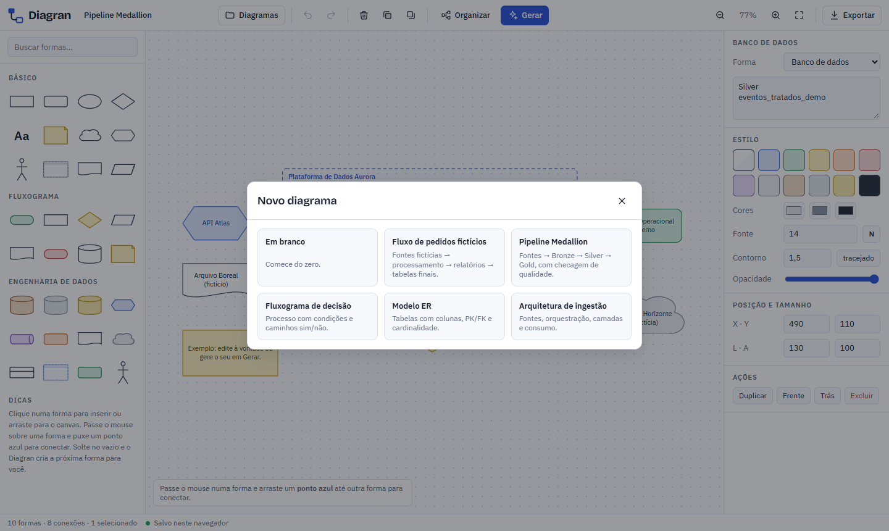

| Modelo | O que traz |
|---|---|
| **Em branco** | Canvas vazio |
| **Fluxo de pedidos fictícios** | Fontes → domínios → relatórios → tabelas finais, em contêineres |
| **Pipeline Medallion** | Fontes → Bronze → Silver → Gold, com checagem de qualidade e reprocessamento |
| **Fluxograma de decisão** | Processo com condições e caminhos sim/não |
| **Modelo ER** | Tabelas com colunas, PK/FK e cardinalidade |
| **Arquitetura de ingestão** | Fontes, orquestração, camadas e consumo |

### 2. Adicionar formas

- **Clique** numa forma da biblioteca para inseri-la no centro, ou **arraste** para onde quiser.
- **Dois cliques numa área vazia** criam uma forma ali.
- **Buscar formas…** acha rápido ("decisão", "kafka", "tabela"…).

### 3. Conectar

1. Passe o mouse sobre uma forma: aparecem **pontos azuis**.
2. **Arraste um ponto azul** até outra forma.
3. **Solte no vazio** e o Diagran cria a próxima forma já conectada.

Com a conexão selecionada, o painel da direita muda **rota** (ortogonal, reta, curva), **rótulo**, **tracejado**, **setas** e **cardinalidade**.

### 4. Escrever e estilizar

- **Dois cliques**, `Enter` ou `F2` editam o texto. Começar a digitar com uma forma selecionada também entra em edição.
- No painel: **12 estilos de cor**, preenchimento, contorno, fonte, negrito, espessura, tracejado e opacidade.

### 5. Organizar

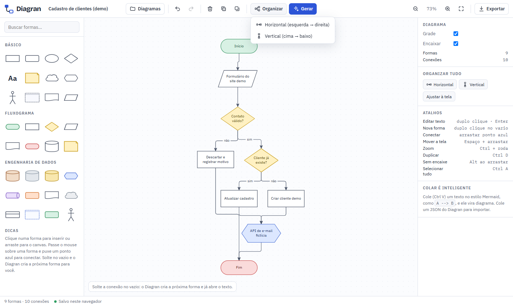

- **Organizar → Horizontal/Vertical** reorganiza o diagrama em camadas (`Ctrl+Shift+L`).
- Com várias formas selecionadas: **Alinhar**, **Distribuir ↔/↕**, **Mesmo tamanho**, **Organizar seleção** e **Agrupar em contêiner**.
- `Shift+1` ajusta tudo à tela.

### 6. Salvar e compartilhar

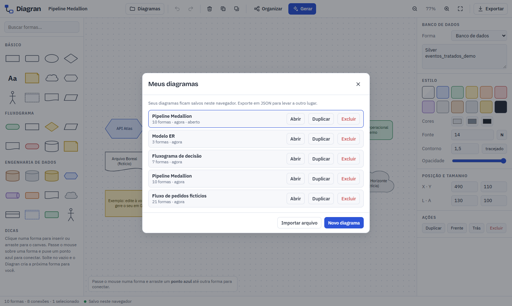

- O diagrama é **salvo automaticamente**. O rodapé mostra onde: *"Salvo neste navegador"* ou *"Salvo na sua conta"* (no artefato do Claude).
- **Exportar → Arquivo Diagran (JSON)** leva o diagrama para outra máquina ou para o Git.
- **Exportar → Imagem PNG / Vetor SVG** para documentos e apresentações.

---

## Usando com o Claude e o Codex

Depois de instalado, **você não precisa abrir arquivo nenhum**: peça ao agente e ele gera a ferramenta para você.

### No Claude

| Peça | O que acontece |
|---|---|
| `/diagran` ou *"abra o Diagran"* | O Claude publica o Diagran como **artefato** e entrega o link. Se você já tem um, ele oferece reabrir em vez de duplicar |
| *"desenhe no Diagran o fluxo de aprovação de pedidos"* | O artefato já abre com o fluxo desenhado e organizado |
| *"transforme este Mermaid em Diagran"* | O Claude converte e entrega o editor com o diagrama pronto |

Dentro do Claude, o artefato ganha recursos extras:

| Recurso | Navegador comum | Artefato no Claude |
|---|:---:|:---:|
| Editor completo, texto → diagrama, importar/exportar | ✅ | ✅ |
| Salvamento no navegador | ✅ | ✅ |
| ✨ **Descrever para a IA** (gerar diagrama a partir de português) | — | ✅ |
| Diagramas **salvos na sua conta** (privados, por pessoa) | — | ✅ |
| Downloads de PNG/SVG/JSON pelo Claude | — | ✅ |

### No Codex

Peça `$diagran` ou *"abra o Diagran"*. O Codex copia a ferramenta para `~/Diagran/diagran.html` e abre no navegador. Para um diagrama pronto, descreva o que quer: o Codex escreve o texto do diagrama e abre o editor com ele carregado.

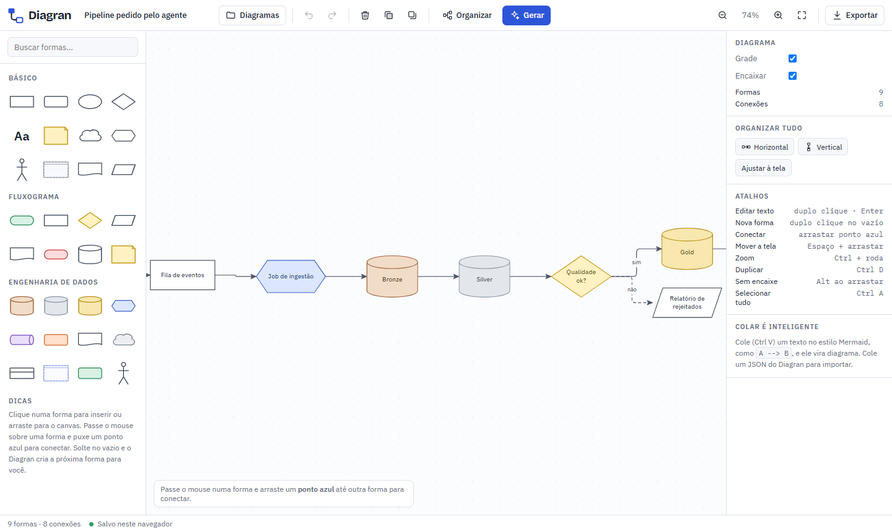

### Como a skill funciona

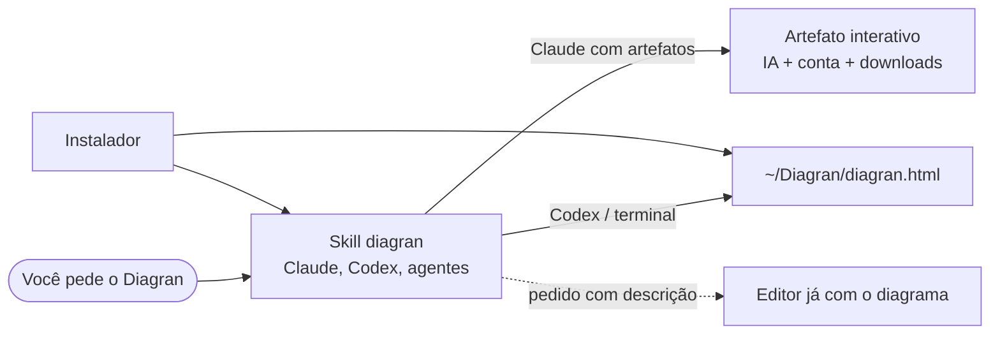

A skill usa sempre o arquivo pronto em `skills/diagran/assets/`, nunca uma versão reescrita: o que você recebe é exatamente o editor deste repositório. Para um diagrama pronto, o agente escreve o texto na [sintaxe do Diagran](skills/diagran/references/SINTAXE.md) e o editor abre com ele já desenhado.

---

## Texto → diagrama (sintaxe estilo Mermaid)

Clique em **✨ Gerar → Texto → diagrama** ou **cole o texto** (`Ctrl+V`) direto no canvas. Marque *"Adicionar ao diagrama atual"* para somar ao que já existe.

```text
flowchart LR
API[API Atlas] --> B[(Bronze)]
B -->|limpeza e dedup| S[(Silver)]
S --> Q{Dados válidos?}
Q -->|sim| G[(Gold)]
Q -.->|não| L[/Log de rejeitados/]
G --> D[Dashboard]
tabela eventos: id_evento bigint PK, email_demo string, dt_criacao timestamp
```

O resultado já sai organizado, com as cores Bronze/Silver/Gold aplicadas sozinhas.

### Formas

| Escreva | Forma gerada |
|---|---|
| `A[Texto]` | Retângulo |
| `A(Texto)` | Retângulo arredondado |
| `A([Início])` | Início/Fim (terminador) |
| `A{Decisão?}` | Losango de decisão |
| `A[(Banco)]` | Cilindro (banco de dados) |
| `A((Texto))` | Elipse |
| `A{{API}}` | Hexágono (serviço/API) |
| `A[/Arquivo/]` | Paralelogramo (entrada/saída) |
| `A>Documento]` | Documento |

### Conexões

| Escreva | Resultado |
|---|---|
| `A --> B`, `A -> B`, `A → B`, `A ==> B` | Seta |
| `A --- B` | Linha sem seta |
| `A -.-> B` | Seta tracejada |
| `A -.- B` | Linha tracejada sem seta |
| `A -->\|rótulo\| B` ou `A -- rótulo --> B` | Seta com rótulo |
| `A --> B & C` | Uma origem para vários destinos |
| `A --> B --> C` | Encadeamento |

### Direção, tabelas e comentários

| Escreva | Efeito |
|---|---|
| `flowchart LR` / `graph LR` | Layout horizontal (padrão) |
| `flowchart TB` / `flowchart TD` | Layout vertical |
| `tabela vendas: id bigint PK, id_cliente bigint FK, valor decimal(12,2)` | Tabela ER com colunas, tipos e chaves |
| `%% comentário` ou `// comentário` | Ignorado |

### Formas inferidas pelo texto

| Se o texto contém… | Vira |
|---|---|
| termina com `?` | Decisão |
| `Início`, `Fim`, `start`, `end` | Início/Fim |
| `bronze`, `silver`, `gold`, `banco`, `delta`, `lake`, `warehouse`, `dw` | Banco de dados |
| `kafka`, `fila`, `queue`, `stream`, `pubsub` | Fila/Stream |
| `api`, `serviço`, `endpoint` | Hexágono |
| `csv`, `arquivo`, `relatório`, `planilha`, `excel`, `pdf` | Documento |
| `usuário`, `cliente`, `analista`, `ator` | Ator |

---

## Atalhos de teclado e mouse

| Ação | Atalho |
|---|---|
| Desfazer / Refazer | `Ctrl+Z` / `Ctrl+Shift+Z` ou `Ctrl+Y` |
| Duplicar | `Ctrl+D` |
| Selecionar tudo | `Ctrl+A` |
| Copiar / Colar formas | `Ctrl+C` / `Ctrl+V` |
| Colar texto Mermaid ou JSON e virar diagrama | `Ctrl+V` no canvas |
| Salvar agora | `Ctrl+S` |
| Meus diagramas | `Ctrl+O` |
| Organizar automaticamente | `Ctrl+Shift+L` |
| Trazer para frente / Enviar para trás | `Ctrl+]` / `Ctrl+[` |
| Zoom | `Ctrl` + roda do mouse, `+` / `-`, `Ctrl+=` / `Ctrl+-` |
| Zoom 100% | `Ctrl+0` |
| Ajustar à tela | `Shift+1` |
| Mover a tela (pan) | `Espaço` + arrastar, ou arrastar com o botão do meio |
| Editar texto | Dois cliques, `Enter` ou `F2` |
| Confirmar texto | `Ctrl+Enter` (ou `Enter` em rótulos de conexão) |
| Nova forma | Dois cliques no vazio |
| Conectar | Arrastar o ponto azul |
| Mover sem encaixar na grade | `Alt` + arrastar |
| Mover 1 px / 1 célula da grade | Setas / `Shift` + setas |
| Seleção múltipla | `Shift`/`Ctrl` + clique, ou arrastar no vazio |
| Excluir | `Delete` ou `Backspace` |
| Limpar seleção / fechar janela | `Esc` |
| Gerar (na janela Gerar) | `Ctrl+Enter` |

> No macOS, use `Cmd` no lugar de `Ctrl`. No celular: toque para selecionar, arraste com um dedo para mover e use pinça para zoom.

---

## Biblioteca de formas

| Categoria | Formas |
|---|---|
| **Básico** | Processo, Etapa, Evento, Decisão, Texto, Nota, Nuvem, Serviço, Usuário (ator), Contêiner, Documento, Entrada |
| **Fluxograma** | Início, Ação, Condição, Dados, Relatório, Fim, Base, Observação |
| **Engenharia de dados** | Bronze, Silver, Gold, API, Fila/Stream, Job, CSV/Arquivo, Nuvem, Tabela (ER), Plataforma (contêiner), Dashboard, Analista |

---

## Importar e exportar

| Formato | Exportar | Importar | Quando usar |
|---|:---:|:---:|---|
| **PNG (2x)** | ✅ | — | Slides, documentos, wikis, e-mail |
| **SVG** | ✅ (arquivo ou copiar) | — | Imagem vetorial nítida em qualquer tamanho |
| **JSON do Diagran** | ✅ | ✅ | Backup, outra máquina, versionar no Git |
| **Mermaid** | ✅ (copiar) | ✅ (colar/gerar) | README, wikis e Markdown que renderizam Mermaid |
| **draw.io / XML** | — | ✅ | Trazer diagramas feitos no draw.io/diagrams.net |

Para importar: **Exportar → Importar arquivo…**, **Diagramas → Importar arquivo**, ou cole o conteúdo no canvas. Uma importação inválida falha sem corromper o diagrama atual.

---

## Privacidade e armazenamento

- 🔒 **Seus diagramas ficam no seu navegador** (`localStorage`). Nada é enviado para servidor nenhum.
- ☁️ No **artefato do Claude**, os diagramas também ficam na sua conta, num espaço **privado de cada pessoa**.
- 🌐 Funciona **offline**, sem contas e sem credenciais. A única requisição externa é a fonte do Google Fonts; offline, o navegador usa uma fonte do sistema.
- 🤖 A IA só existe dentro do Claude e só é chamada quando você clica em **Gerar**.
- 🧪 Todos os exemplos usam **dados fictícios** (API Atlas, CRM Aurora, Arquivo Boreal etc.).

> Limpar os dados do site ou trocar de navegador apaga a biblioteca local. **Exporte em JSON** os diagramas importantes.

Mais detalhes em [docs/PRIVACY.md](docs/PRIVACY.md).

---

## Perguntas frequentes

<details>
<summary><b>Preciso instalar alguma coisa além do comando?</b></summary>

Não. O instalador só copia arquivos (não pede administrador, não instala Node, Python nem dependências). O PowerShell e o bash/curl já vêm no sistema.
</details>

<details>
<summary><b>Instalei, mas o agente não reconhece o Diagran.</b></summary>

Abra uma **nova conversa** (as skills são lidas no início). No Claude Code, confira se existe `~/.claude/skills/diagran/SKILL.md`; no Codex, `~/.codex/skills/diagran/SKILL.md`.
</details>

<details>
<summary><b>Onde meus diagramas ficam salvos?</b></summary>

No navegador em que você os criou e, no artefato do Claude, também na sua conta. Para backup use **Exportar → Arquivo Diagran (JSON)**.
</details>

<details>
<summary><b>Por que a aba "Descrever para a IA" está desabilitada?</b></summary>

A geração por IA depende do Claude. Num navegador comum, use a aba **Texto → diagrama**, que funciona em qualquer lugar, ou peça ao agente para escrever o texto por você.
</details>

<details>
<summary><b>O Diagran é compatível com Mermaid?</b></summary>

Ele entende a parte mais usada do *flowchart* (formas, setas, rótulos, tracejado, direção) e exporta para Mermaid. `subgraph`, `classDef` e `style` são ignorados na importação.
</details>

<details>
<summary><b>Consigo abrir diagramas do draw.io?</b></summary>

Sim: **Exportar → Importar arquivo…** e selecione o `.drawio` ou o XML.
</details>

<details>
<summary><b>Como atualizo para uma versão nova?</b></summary>

Rode o mesmo comando de instalação. Ele substitui a skill e a ferramenta, sem tocar nos diagramas salvos.
</details>

<details>
<summary><b>Posso usar na empresa ou em projetos comerciais?</b></summary>

Sim, sob a licença [MIT](LICENSE).
</details>

---

## Estrutura do repositório

```text
.
├── src/diagran.html                 # código-fonte do editor (edite aqui)
├── app/index.html                   # gerado: abre direto no navegador
├── skills/diagran/                  # a skill instalada no Claude e no Codex
│   ├── SKILL.md                     #   instruções para o agente
│   ├── agents/openai.yaml           #   metadados para o Codex
│   ├── assets/diagran.html          #   gerado: documento completo
│   ├── assets/diagran-artifact.html #   gerado: versão para artefato do Claude
│   └── references/SINTAXE.md        #   sintaxe texto → diagrama
├── .claude-plugin/                  # plugin e marketplace do Claude Code
├── install.ps1 · install.sh         # instalação em um comando
├── uninstall.ps1 · uninstall.sh     # desinstalação
├── scripts/build.py                 # gera app/ e assets/ a partir de src/
├── scripts/screenshots.py           # gera as imagens deste README
├── tests/                           # validação do repositório e teste no navegador
├── docs/                            # arquitetura, funcionalidades, privacidade, desenvolvimento
└── .github/                         # CI, release, modelos de issue e PR
```

---

## Desenvolvimento e contribuição

```bash
python scripts/build.py              # gera app/index.html e os assets da skill
python tests/validate_repo.py        # skill, plugin, versões, instaladores, README
python tests/test_smoke.py           # abre o editor num navegador real (Playwright)
python scripts/screenshots.py        # atualiza as imagens do README
```

Edite só `src/diagran.html`; os demais HTML são gerados. Leia [CONTRIBUTING.md](CONTRIBUTING.md) e [docs/DEVELOPMENT.md](docs/DEVELOPMENT.md). Encontrou um problema? Abra uma [issue](https://github.com/carlos-dataengineer/diagram/issues). Vulnerabilidades: [SECURITY.md](SECURITY.md). Suporte: [SUPPORT.md](SUPPORT.md). Mudanças: [CHANGELOG.md](CHANGELOG.md).

---

## Licença

[MIT](LICENSE). Use, modifique e distribua à vontade.
