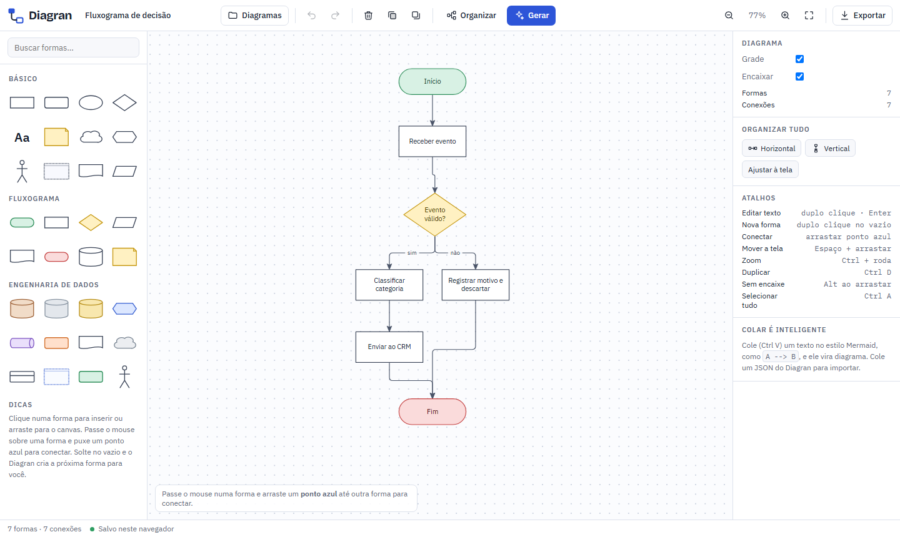
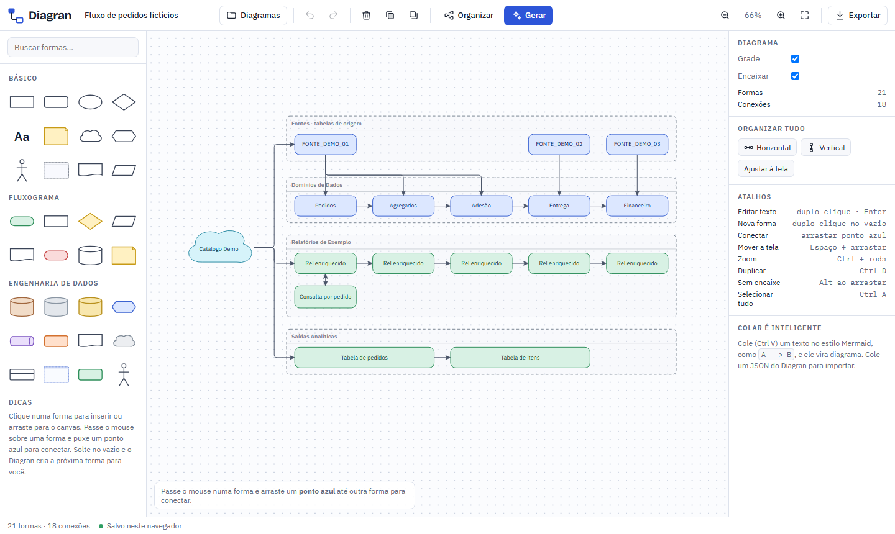
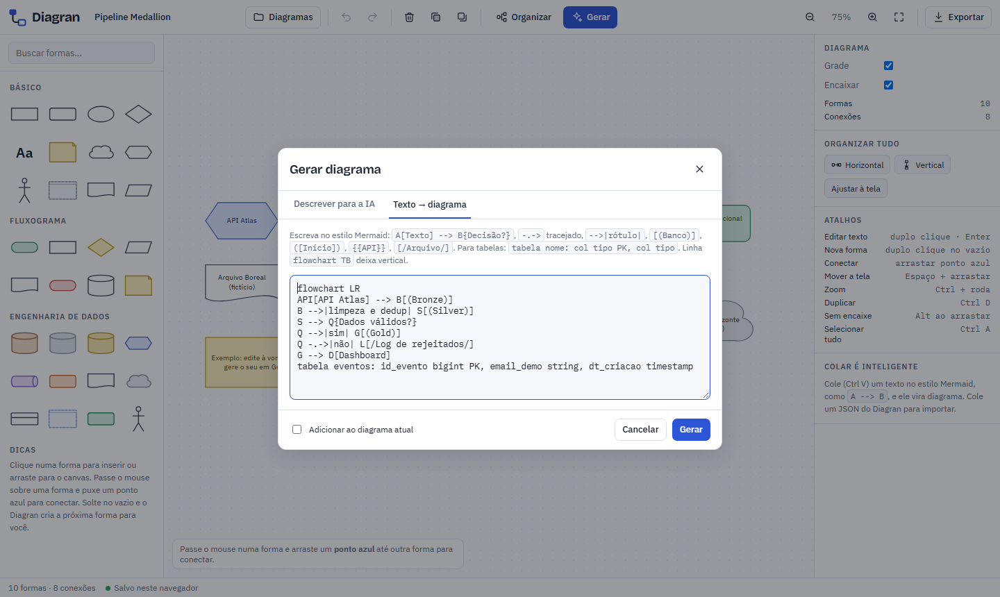
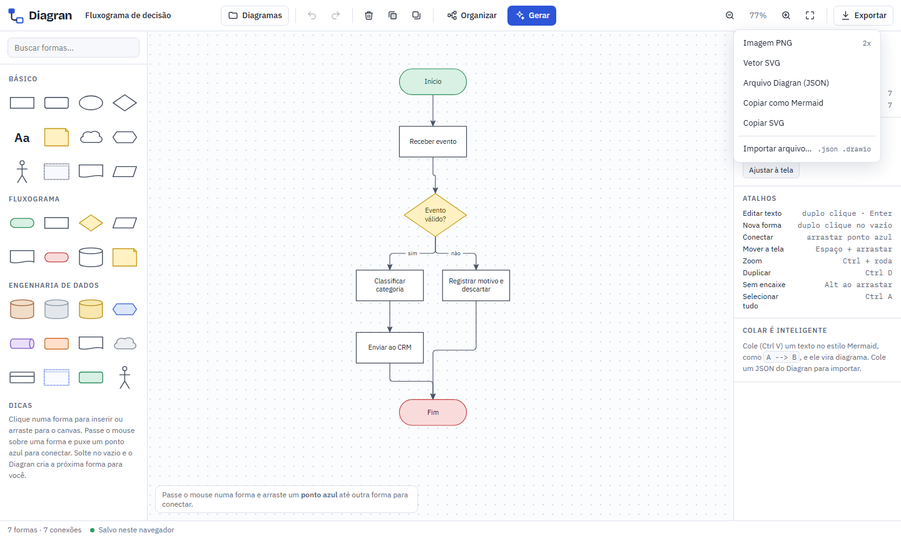
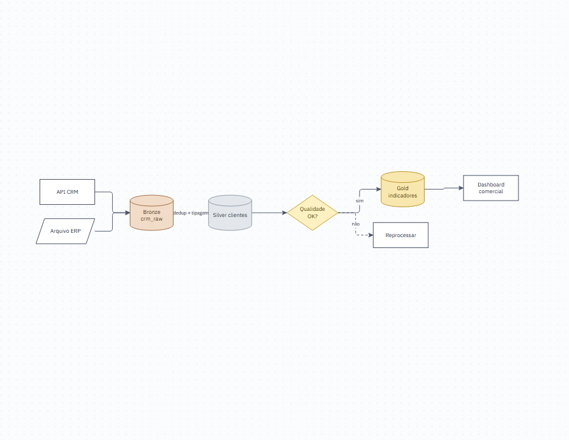
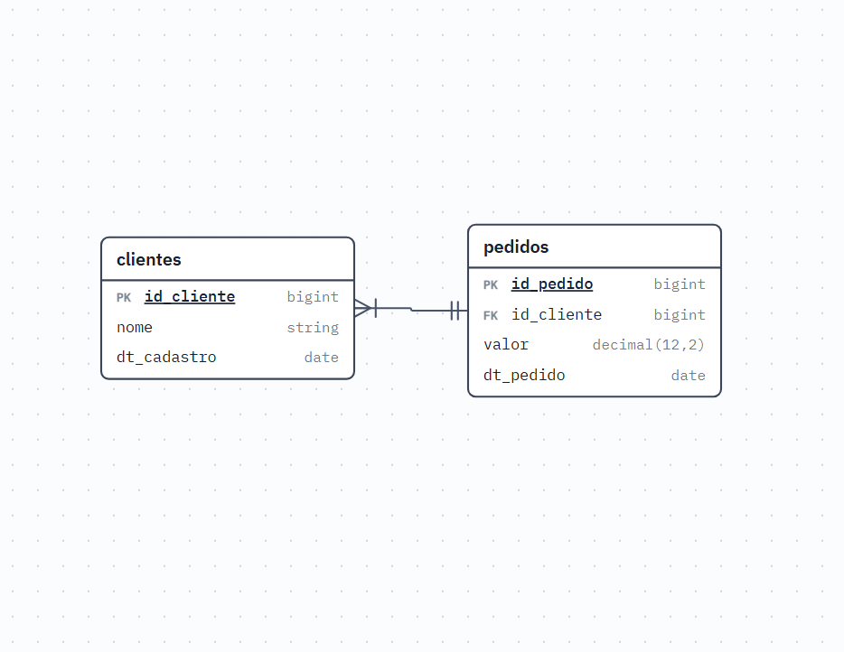
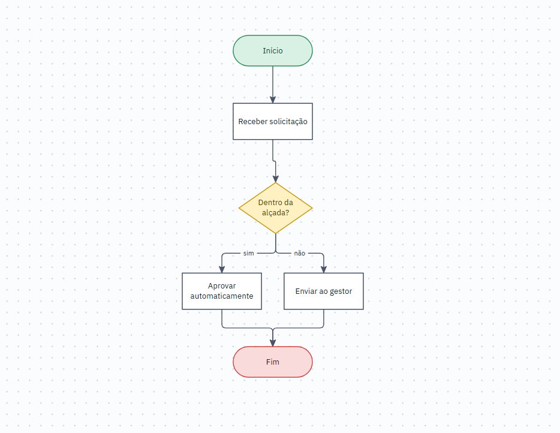
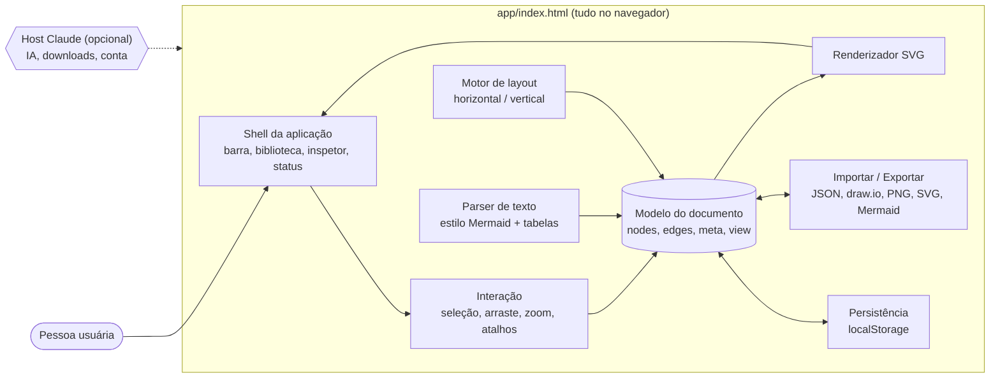

<div align="center">

# Diagran

**Ferramenta visual para desenhar fluxogramas, pipelines de dados, arquiteturas e modelos ER direto no navegador.**

Um único arquivo HTML. Sem instalação, sem build, sem servidor, sem cadastro.


</div>

> O nome do repositório é **diagram**; o nome da ferramenta é **Diagran**.

---

## Sumário

- [O que é o Diagran](#o-que-é-o-diagran)
- [Destaques](#destaques)
- [Galeria](#galeria)
- [Começando em 1 minuto](#começando-em-1-minuto)
- [Conhecendo a interface](#conhecendo-a-interface)
- [Guia passo a passo](#guia-passo-a-passo)
- [Texto → diagrama (sintaxe estilo Mermaid)](#texto--diagrama-sintaxe-estilo-mermaid)
- [Biblioteca de formas](#biblioteca-de-formas)
- [Atalhos de teclado e mouse](#atalhos-de-teclado-e-mouse)
- [Importar e exportar](#importar-e-exportar)
- [Casos de uso](#casos-de-uso)
- [Usando como Skill em agentes de IA](#usando-como-skill-em-agentes-de-ia)
- [Arquitetura](#arquitetura)
- [Privacidade e armazenamento](#privacidade-e-armazenamento)
- [Perguntas frequentes](#perguntas-frequentes)
- [Estrutura do repositório](#estrutura-do-repositório)
- [Contribuindo](#contribuindo)
- [Licença](#licença)

---

## O que é o Diagran

O Diagran é um editor de diagramas **leve e portátil**, pensado para quem precisa explicar um processo, uma arquitetura ou um modelo de dados **rápido**, sem abrir uma ferramenta pesada nem criar conta em nenhum serviço.

Ele foi desenhado com um olhar especial para **engenharia de dados**. Tem formas prontas para camadas Bronze/Silver/Gold, filas e streams, jobs Spark, APIs, arquivos e dashboards. Também tem um modelo ER com PK/FK e cardinalidade.

Você pode desenhar de três jeitos:

| Jeito | Como funciona | Ideal para |
|---|---|---|
| 🖱️ **Arrastar e soltar** | Clique ou arraste formas da biblioteca, conecte puxando o ponto azul | Ajustes finos, apresentações |
| ⌨️ **Escrever texto** | Digite `A --> B{Decisão?}` e o Diagran monta e organiza o desenho | Rapidez, versionar diagramas como texto |
| ✨ **Descrever para a IA** | Explique o processo em português e a IA monta as formas *(somente quando aberto no Claude)* | Primeiro rascunho de algo complexo |

---

## Destaques

- **Zero instalação.** É só abrir `app/index.html` em qualquer navegador moderno, inclusive offline.
- **Feito para engenharia de dados.** Traz formas prontas de Bronze/Silver/Gold, filas, jobs Spark, APIs e tabelas ER.
- **Layout automático.** Organize tudo na horizontal ou na vertical com um clique (`Ctrl+Shift+L`).
- **Colar é inteligente.** Cole (`Ctrl+V`) um texto Mermaid e ele vira diagrama. Cole um JSON do Diagran e ele é importado.
- **Criação rápida.** Puxe uma conexão para uma área vazia e o Diagran cria a próxima etapa para você.
- **Conexões completas:** rotas ortogonais, retas ou curvas, setas, rótulos, tracejado e cardinalidade ER.
- **Modelo ER de verdade.** Tabelas com colunas, tipos, PK e FK.
- **Contêineres** para agrupar etapas (por exemplo, "Plataforma de Dados").
- **Alinhar, distribuir e igualar tamanho** de formas selecionadas.
- **Tema claro e escuro**, que acompanha o sistema operacional.
- **Desfazer/refazer**, duplicar, trazer para frente e enviar para trás.
- **Salvamento automático** no navegador e uma biblioteca local "Meus diagramas".
- **Exporta** PNG (2x), SVG, JSON e Mermaid. **Importa** JSON, draw.io/XML e texto.

---

## Galeria

Todos os exemplos abaixo vêm dos **modelos prontos** que acompanham a ferramenta e usam dados **fictícios**.

<table>
<tr>
<td width="50%"><b>Fluxograma de decisão</b><br></td>
<td width="50%"><b>Modelo ER</b><br></td>
</tr>
<tr>
<td width="50%"><b>Arquitetura de ingestão (tema escuro)</b><br></td>
<td width="50%"><b>Fluxo de pedidos com contêineres</b><br></td>
</tr>
<tr>
<td width="50%"><b>Gerar diagrama a partir de texto</b><br></td>
<td width="50%"><b>Menu de exportação</b><br></td>
</tr>
</table>

---

## Começando em 1 minuto

### Opção 1: abrir no navegador (recomendado)

1. Baixe o projeto: botão verde **Code → Download ZIP**, ou:
   ```bash
   git clone https://github.com/carlos-dataengineer/diagram.git
   ```
2. Abra o arquivo **`app/index.html`** com dois cliques. Ele abre no Chrome, Edge, Firefox ou Safari.
3. Pronto. Comece pelo botão **Diagramas → Novo diagrama** e escolha um modelo.

> 💡 Não precisa de internet, servidor, Node, Python nem permissão de administrador.

### Opção 2: servir numa rede ou intranet

Qualquer servidor de arquivos estáticos funciona:

```bash
cd app
python -m http.server 8080
# abra http://localhost:8080
```

Também dá para publicar a pasta `app/` no **GitHub Pages**, num bucket estático ou na intranet da empresa.

### Opção 3: usar como Skill no Claude

Veja [Usando como Skill em agentes de IA](#usando-como-skill-em-agentes-de-ia).

---

## Conhecendo a interface

```
┌───────────────────────────────────────────────────────────────────────────────┐
│ Diagran  [Nome do diagrama]  Diagramas │ ↶ ↷ │ 🗑 ⧉ ▣ │ Organizar  ✨Gerar │ − 75% + ⛶ │ Exportar │  ← barra superior
├──────────────┬───────────────────────────────────────────────┬────────────────┤
│ Buscar formas│                                               │ PROPRIEDADES   │
│              │                                               │                │
│ BÁSICO       │                                               │ Sem seleção:   │
│ ▭ ▢ ◯ ◇      │              ÁREA DE DESENHO                  │  grade, encaixe│
│ FLUXOGRAMA   │          (grade, zoom, pan, seleção)          │  organizar tudo│
│ ⬭ ▭ ◇ ▱      │                                               │  atalhos       │
│ ENG. DE DADOS│                                               │ Com seleção:   │
│ 🛢 🛢 🛢 ⬡   │                                               │  cores, fonte, │
│              │                                               │  alinhar, ações│
│ DICAS        │                                               │                │
├──────────────┴───────────────────────────────────────────────┴────────────────┤
│ 10 formas · 8 conexões   ● Salvo neste navegador                              │  ← barra de status
└───────────────────────────────────────────────────────────────────────────────┘
```

| Área | Para que serve |
|---|---|
| **Barra superior** | Nome do diagrama, biblioteca (*Diagramas*), desfazer/refazer, excluir, duplicar, ordem, *Organizar*, *Gerar*, zoom e *Exportar* |
| **Biblioteca de formas** (esquerda) | Formas por categoria, com busca. Clique para inserir ou arraste para o canvas |
| **Área de desenho** (centro) | Canvas em SVG com grade opcional, zoom e navegação livre |
| **Painel de propriedades** (direita) | Muda conforme a seleção: estilo, cores, fonte, contorno, opacidade, alinhamento, distribuição e ações |
| **Barra de status** (rodapé) | Contagem de formas e conexões, seleção atual e estado do salvamento |

---

## Guia passo a passo

### 1. Criar um diagrama

Clique em **Diagramas** (`Ctrl+O`) → **Novo diagrama** e escolha um ponto de partida:


| Modelo | O que traz |
|---|---|
| **Em branco** | Canvas vazio |
| **Fluxo de pedidos fictícios** | Fontes → processamento → relatórios → tabelas finais, organizados em contêineres |
| **Pipeline Medallion** | Fontes → Bronze → Silver → Gold, com checagem de qualidade e reprocessamento |
| **Fluxograma de decisão** | Processo com condições e caminhos sim/não |
| **Modelo ER** | Tabelas com colunas, PK/FK e cardinalidade |
| **Arquitetura de ingestão** | Fontes, orquestração, camadas e consumo |

### 2. Adicionar formas

- **Clique** numa forma da biblioteca para inseri-la no centro da tela, ou **arraste** para onde quiser.
- **Dê dois cliques numa área vazia** para criar uma forma ali.
- Use **Buscar formas…** para achar rápido ("decisão", "kafka", "tabela"…).

### 3. Conectar

1. Passe o mouse sobre uma forma. Aparecem **pontos azuis**.
2. **Arraste um ponto azul** até outra forma.
3. **Solte no vazio** e o Diagran cria a próxima forma já conectada.

Com a conexão selecionada, no painel da direita você escolhe a **rota** (ortogonal, reta, curva), o **rótulo**, o **tracejado**, as **setas** e a **cardinalidade**.

### 4. Escrever e estilizar

- **Duplo clique** ou **Enter/F2** edita o texto. Começar a digitar com uma forma selecionada também entra em edição.
- No painel: **12 cores de estilo** (inclusive Bronze, Silver e Gold), preenchimento, contorno, fonte, negrito, espessura, tracejado e opacidade.

### 5. Organizar

- **Organizar → Horizontal/Vertical** reorganiza o diagrama inteiro em camadas.
- Com várias formas selecionadas: **Alinhar** (esquerda, centro, direita, topo, meio, base), **Distribuir ↔/↕**, **Mesmo tamanho**, **Organizar seleção** e **Agrupar em contêiner**.
- `Shift+1` ajusta tudo à tela.

### 6. Salvar e compartilhar

- O diagrama é **salvo automaticamente** no navegador. O rodapé mostra *"Salvo neste navegador"*.
- Para levar a outra máquina ou para o Git, use **Exportar → Arquivo Diagran (JSON)**.
- Para documentos e apresentações, use **Exportar → Imagem PNG** ou **Vetor SVG**.

---

## Texto → diagrama (sintaxe estilo Mermaid)

Clique em **✨ Gerar → Texto → diagrama** ou simplesmente **cole o texto** (`Ctrl+V`) no canvas. Marque *"Adicionar ao diagrama atual"* para somar ao que já existe.

### Exemplo completo

```text
flowchart LR
API[API Atlas] --> B[(Bronze)]
B -->|limpeza e dedup| S[(Silver)]
S --> Q{Dados válidos?}
Q -->|sim| G[(Gold)]
Q -.->|não| L[/Log de rejeitados/]
G --> D[Dashboard]
tabela eventos: id_evento bigint PK, email_demo string, dt_criacao timestamp
```

O resultado já sai organizado, com as cores Bronze/Silver/Gold aplicadas automaticamente.

### Formas

| Escreva | Forma gerada |
|---|---|
| `A[Texto]` | Retângulo |
| `A(Texto)` | Retângulo arredondado |
| `A([Início])` | Início/Fim (terminador) |
| `A{Decisão?}` | Losango de decisão |
| `A[(Banco)]` | Cilindro (banco de dados) |
| `A((Texto))` | Elipse |
| `A{{API}}` | Hexágono (serviço/API) |
| `A[/Arquivo/]` | Paralelogramo (entrada/saída) |
| `A>Documento]` | Documento |

### Conexões

| Escreva | Resultado |
|---|---|
| `A --> B` ou `A -> B` ou `A → B` | Seta |
| `A --- B` | Linha sem seta |
| `A -.-> B` | Seta tracejada |
| `A -.- B` | Linha tracejada sem seta |
| `A ==> B` | Seta |
| `A -->\|rótulo\| B` ou `A -- rótulo --> B` | Seta com rótulo |
| `A --> B & C` | Uma origem para vários destinos |
| `A --> B --> C` | Encadeamento |

### Direção, tabelas e comentários

| Escreva | Efeito |
|---|---|
| `flowchart LR` / `graph LR` | Layout horizontal (padrão) |
| `flowchart TB` / `flowchart TD` | Layout vertical |
| `tabela vendas: id bigint PK, id_cliente bigint FK, valor decimal(12,2)` | Tabela ER com colunas, tipos e chaves |
| `%% comentário` ou `// comentário` | Ignorado |

### Formas inferidas pelo texto

Se você não indicar a forma, o Diagran escolhe pela palavra usada:

| Se o texto contém… | Vira |
|---|---|
| termina com `?` | Decisão |
| `Início`, `Fim`, `start`, `end` | Início/Fim |
| `bronze`, `silver`, `gold`, `banco`, `delta`, `lake`, `warehouse`, `oracle`, `dw` | Banco de dados |
| `kafka`, `fila`, `queue`, `stream`, `pubsub` | Fila/Stream |
| `api`, `serviço`, `endpoint` | Hexágono |
| `csv`, `arquivo`, `relatório`, `planilha`, `excel`, `pdf` | Documento |
| `usuário`, `cliente`, `analista`, `ator` | Ator |

---

## Biblioteca de formas

| Categoria | Formas |
|---|---|
| **Básico** | Processo, Etapa, Evento, Decisão, Texto, Nota, Nuvem, Serviço, Usuário (ator), Contêiner, Documento, Entrada |
| **Fluxograma** | Início, Ação, Condição, Dados, Relatório, Fim, Base, Observação |
| **Engenharia de dados** | Bronze, Silver, Gold, API, Kafka/Fila, Job Spark, CSV/Arquivo, Nuvem, Tabela (ER), Plataforma (contêiner), Dashboard, Analista |

Tipos de forma suportados: retângulo, arredondado, elipse, decisão, entrada/saída, hexágono, banco de dados, fila/stream, documento, nuvem, nota, início/fim, texto, ator, tabela ER e contêiner.

---

## Atalhos de teclado e mouse

| Ação | Atalho |
|---|---|
| Desfazer / Refazer | `Ctrl+Z` / `Ctrl+Shift+Z` ou `Ctrl+Y` |
| Duplicar | `Ctrl+D` |
| Selecionar tudo | `Ctrl+A` |
| Salvar agora | `Ctrl+S` |
| Meus diagramas | `Ctrl+O` |
| Organizar automaticamente | `Ctrl+Shift+L` |
| Trazer para frente / Enviar para trás | `Ctrl+]` / `Ctrl+[` |
| Zoom | `Ctrl` + roda do mouse, `+` / `-`, `Ctrl+=` / `Ctrl+-` |
| Ajustar à tela | `Shift+1` |
| Mover a tela (pan) | `Espaço` + arrastar |
| Editar texto | Duplo clique, `Enter` ou `F2` |
| Nova forma | Duplo clique no vazio |
| Conectar | Arrastar o ponto azul |
| Mover sem encaixar na grade | `Alt` + arrastar |
| Mover 1 px / 1 célula da grade | Setas / `Shift` + setas |
| Seleção múltipla | `Shift`/`Ctrl` + clique |
| Excluir | `Delete` ou `Backspace` |
| Limpar seleção / fechar janela | `Esc` |

> No macOS, use `Cmd` no lugar de `Ctrl`.

---

## Importar e exportar

| Formato | Exportar | Importar | Quando usar |
|---|:---:|:---:|---|
| **PNG (2x)** | ✅ | — | Slides, documentos, Confluence, e-mail |
| **SVG** | ✅ (arquivo ou copiar) | — | Imagem vetorial nítida em qualquer tamanho, sites |
| **JSON do Diagran** | ✅ | ✅ | Backup, levar para outra máquina, versionar no Git |
| **Mermaid** | ✅ (copiar) | ✅ (colar/gerar) | Colar em README, wikis e Markdown que renderizam Mermaid |
| **draw.io / XML** | — | ✅ | Trazer diagramas feitos no draw.io/diagrams.net |

Para importar: **Exportar → Importar arquivo…** (`.json`, `.drawio`), **Diagramas → Importar arquivo**, ou cole o conteúdo no canvas. Uma importação inválida falha sem corromper o diagrama atual.

---

## Casos de uso

### 1. Documentar um pipeline de dados (Medallion)
Mostre de onde o dado vem, como passa por Bronze → Silver → Gold e quem consome. Comece pelo modelo **Pipeline Medallion**, troque os nomes e exporte em PNG para o README do pipeline.

```text
flowchart LR
CRM[API CRM] --> B[(Bronze crm_raw)]
ERP[/Arquivo ERP/] --> B
B -->|dedup + tipagem| S[(Silver clientes)]
S --> Q{Qualidade OK?}
Q -->|sim| G[(Gold indicadores)]
Q -.->|não| R[Reprocessar]
G --> P[Dashboard comercial]
```



### 2. Modelar tabelas antes de criar no banco
Use o modelo **Modelo ER** ou escreva as tabelas em texto. PK e FK aparecem destacadas, e as relações mostram a cardinalidade.

```text
tabela clientes: id_cliente bigint PK, nome string, dt_cadastro date
tabela pedidos: id_pedido bigint PK, id_cliente bigint FK, valor decimal(12,2), dt_pedido date
clientes --> pedidos
```



### 3. Fluxograma de processo de negócio
Mapeie aprovações, exceções e caminhos sim/não para alinhar com áreas de negócio, auditoria ou onboarding.

```text
flowchart TB
I([Início]) --> A[Receber solicitação]
A --> B{Dentro da alçada?}
B -->|sim| C[Aprovar automaticamente]
B -->|não| D[Enviar ao gestor]
C --> F([Fim])
D --> F
```



### 4. Desenho de arquitetura de solução
Agrupe componentes em **contêineres** (ex.: "Plataforma de Dados", "Nuvem"), use hexágonos para APIs e filas para streams, e conexões tracejadas para fluxos assíncronos.

### 5. Investigação de incidente / análise de causa raiz
Desenhe a cadeia de dependências de um job que falhou: o que veio antes, o que foi afetado e onde reprocessar. As setas tracejadas servem para indicar reprocessamentos ou caminhos alternativos.

### 6. Diagramas versionados junto com o código
Guarde o diagrama como **texto Mermaid** ou **JSON** no próprio repositório. Na revisão de código, a mudança do desenho aparece no *diff*. Quando precisar editar, cole de volta no Diagran.

### 7. Reuniões e workshops ao vivo
Compartilhe a tela e desenhe junto com o time: crie formas com duplo clique, conecte soltando no vazio e reorganize com `Ctrl+Shift+L` no final.

### 8. Material de treinamento e onboarding
Explique para quem está chegando como os sistemas se conectam. Exporte em SVG para que a imagem fique nítida em qualquer tela.

---

## Usando como Skill em agentes de IA

O repositório é também uma **Skill** (veja [`SKILL.md`](SKILL.md)). Quando acionada, ela entrega a aplicação `app/index.html` **inteira** como um artefato interativo, e não uma imagem estática ou um resumo.

### Instalação no Claude Code

```bash
# Windows (PowerShell)
git clone https://github.com/carlos-dataengineer/diagram.git "$env:USERPROFILE\.claude\skills\diagran"

# Linux / macOS
git clone https://github.com/carlos-dataengineer/diagram.git ~/.claude/skills/diagran
```

Depois é só pedir: *"abra o Diagran"* ou *"quero desenhar um fluxograma no Diagran"*.

### O que muda quando aberto no Claude

| Recurso | Navegador comum | Dentro do Claude |
|---|:---:|:---:|
| Editor completo, texto → diagrama, import/export | ✅ | ✅ |
| Salvamento local | ✅ | ✅ |
| **Descrever para a IA** (gerar por linguagem natural) | — | ✅ |
| Persistência na conta / downloads pelo host | — | ✅ (quando o ambiente oferece) |

Fora do Claude, a aba de IA mostra que o recurso está indisponível, e todo o resto continua funcionando.

---

## Arquitetura

O Diagran é uma aplicação **100% client-side**, entregue em um único HTML com HTML/CSS para a interface e **SVG** para o desenho.



| Componente | Responsabilidade |
|---|---|
| **Modelo do documento** | `nodes` (tipo, posição, tamanho, texto, estilo), `edges` (origem, destino, rótulo, estilo), `meta` (id, nome) e `view` (zoom e posição) |
| **Renderizador SVG** | Transforma o modelo em desenho vetorial |
| **Motor de layout** | Organiza as formas em camadas, na horizontal ou na vertical |
| **Parser de texto** | Converte a sintaxe estilo Mermaid e as declarações de tabela em formas e conexões |
| **Persistência** | `localStorage` por padrão; integração opcional com o host Claude |

Mais detalhes em [`docs/ARCHITECTURE.md`](docs/ARCHITECTURE.md).

---

## Privacidade e armazenamento

- 🔒 **Seus diagramas ficam no seu navegador** (`localStorage`). O conteúdo dos diagramas não é enviado para nenhum servidor.
- 🌐 Funciona **offline**, sem contas e sem credenciais. A única requisição externa é a fonte tipográfica do Google Fonts, carregada quando há internet. Offline, o navegador usa uma fonte do sistema.
- 🤖 Recursos de IA e de nuvem só existem quando o **ambiente host** (Claude) os oferece, e nunca são acionados sem uma ação sua.
- 🧪 Todos os exemplos e modelos usam **dados fictícios** (API Atlas, CRM Aurora, Arquivo Boreal etc.).
- ⚠️ Evite colocar senhas, tokens ou dados pessoais em diagramas que serão compartilhados.

> Como o salvamento é por navegador, limpar os dados do site ou trocar de navegador apaga a biblioteca local. **Exporte em JSON** os diagramas importantes.

Mais detalhes em [`docs/PRIVACY.md`](docs/PRIVACY.md).

---

## Perguntas frequentes

<details>
<summary><b>Preciso instalar alguma coisa?</b></summary>

Não. Basta um navegador moderno (Chrome, Edge, Firefox ou Safari). Abra `app/index.html` e pronto.
</details>

<details>
<summary><b>Onde meus diagramas ficam salvos?</b></summary>

No armazenamento local do navegador em que você os criou. Para backup ou para levar a outra máquina, use **Exportar → Arquivo Diagran (JSON)**.
</details>

<details>
<summary><b>Consigo abrir diagramas do draw.io?</b></summary>

Sim. Use **Exportar → Importar arquivo…** e selecione o `.drawio` ou o XML.
</details>

<details>
<summary><b>O Diagran é compatível com Mermaid?</b></summary>

Ele entende a parte mais usada da sintaxe de *flowchart* (formas, setas, rótulos, tracejado, direção) e exporta para Mermaid. Comandos como `subgraph`, `classDef` e `style` são ignorados na importação.
</details>

<details>
<summary><b>Por que a aba "Descrever para a IA" está desabilitada?</b></summary>

A geração por IA depende do ambiente Claude. Num navegador comum, use a aba **Texto → diagrama**, que funciona em qualquer lugar.
</details>

<details>
<summary><b>Posso usar na empresa ou em projetos comerciais?</b></summary>

Sim. O projeto é licenciado sob MIT. Veja [LICENSE](LICENSE).
</details>

---

## Estrutura do repositório

```text
.
├── app/
│   └── index.html            # a aplicação completa (HTML + CSS + JS)
├── docs/
│   ├── ARCHITECTURE.md       # componentes e modelo de dados
│   ├── FEATURES.md           # lista de funcionalidades
│   ├── PRIVACY.md            # privacidade e armazenamento
│   ├── DEVELOPMENT.md        # como desenvolver e testar
│   └── images/               # capturas de tela usadas neste README
├── tests/
│   └── manual-test-plan.md   # roteiro de testes manuais
├── .github/
│   ├── ISSUE_TEMPLATE/       # modelo de relato de bug
│   └── workflows/            # verificação automática do HTML
├── SKILL.md                  # instruções da Skill para agentes
├── CHANGELOG.md
├── CONTRIBUTING.md
├── CODE_OF_CONDUCT.md
├── SECURITY.md
└── LICENSE
```

---

## Contribuindo

Contribuições são bem-vindas! Antes de abrir um PR:

1. Leia [`CONTRIBUTING.md`](CONTRIBUTING.md) e [`docs/DEVELOPMENT.md`](docs/DEVELOPMENT.md).
2. Mantenha a aplicação **sem build e sem dependências obrigatórias**.
3. Use apenas **dados fictícios** em exemplos.
4. Rode o roteiro de [`tests/manual-test-plan.md`](tests/manual-test-plan.md), principalmente importação/exportação.

Encontrou um problema? Abra uma [issue](https://github.com/carlos-dataengineer/diagram/issues). Vulnerabilidades: veja [`SECURITY.md`](SECURITY.md).

---

## Licença

Distribuído sob a licença **MIT**. Consulte [LICENSE](LICENSE).
